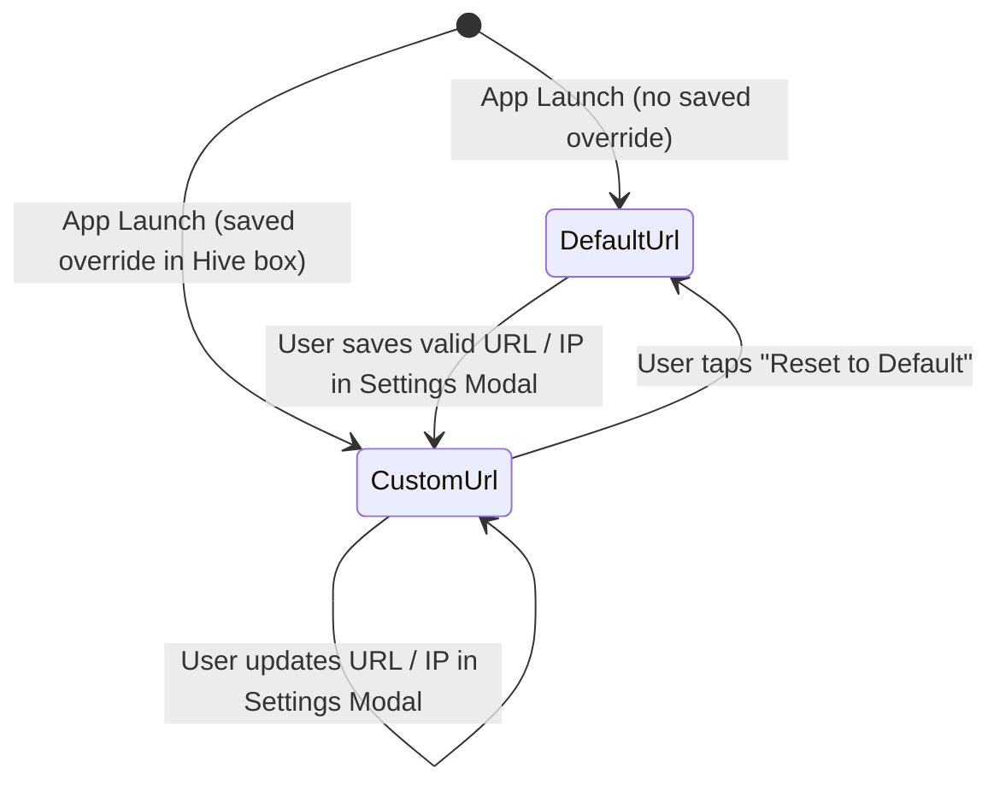

# Phase 1 Data Model: Configurable Server Connection Settings

**Feature**: `004-configurable-api-url`  
**Date**: 2026-10-12

## Entities

### 1. `AppConfig` (Extended in `lib/core/config/app_config.dart`)

Represents the centralized runtime configuration for the mobile application and all backend microservice endpoints.

| Field | Type | Description |
|-------|------|-------------|
| `environment` | `AppEnvironment` | Active environment enum (`local`, `uat`, `production`). |
| `apiBaseUrl` | `String` | Active normalized base URL used by `ApiClient` (e.g., `http://192.168.1.50:8080/api/v1`). |
| `customBaseUrl` | `String?` | Optional user-configured custom base URL override persisted on device; `null` when using platform default. |
| `authServiceUrl` | `String` | Resolved base URL for Auth & Identity microservice calls (synchronized with `apiBaseUrl`). |
| `careServiceUrl` | `String` | Resolved base URL for Care, Vitals, Nutrition, Mood, Memory, and Montessori microservice calls (synchronized with `apiBaseUrl`). |
| `aiServiceUrl` | `String` | Resolved base URL for AI Assistant microservice calls (synchronized with `apiBaseUrl`). |
| `geminiApiKey` | `String` | Optional compile-time Gemini API key. |
| `useMockData` | `bool` | Whether repositories bypass HTTP calls and use offline mock fixtures exclusively. |

**Computed Properties**:
- `bool get isCustomUrlActive`: Returns `true` when `customBaseUrl != null && customBaseUrl!.isNotEmpty`.
- `String get defaultBaseUrl`: Returns the platform default base URL (`http://10.0.2.2:8080/api/v1` on Android, `http://localhost:8080/api/v1` on iOS/macOS/Web, or compile-time `API_BASE_URL`).

---

### 2. `ConnectionTestResult` (`lib/core/config/app_config.dart` or `lib/presentation/shared/server_settings_modal.dart`)

Represents the outcome of testing reachability against a candidate microservices base URL from the Settings panel.

| Field | Type | Description |
|-------|------|-------------|
| `isSuccess` | `bool` | `true` if the server responded with HTTP 2xx within the timeout window. |
| `normalizedUrl` | `String` | The normalized base URL that was tested. |
| `message` | `String` | User-facing status message (e.g., `"Connected successfully to server"` or `"Unable to reach server at ..."`). |
| `latencyMs` | `int?` | Round-trip response time in milliseconds when successful. |

---

## Validation & Normalization Rules

1. **Non-empty check**: Input string trimmed of whitespace must not be empty.
2. **Shorthand expansion**:
   - If input does not start with `http://` or `https://` (case-insensitive):
     - Prepend `http://`.
     - If no port is specified on the host authority, default port to `:8080`.
3. **Path normalization**:
   - If the parsed URI path is empty or `'/'`, set path to `'/api/v1'`.
   - Remove any trailing slashes from the resulting URL.
4. **Host & Scheme validation**:
   - Scheme must be `http` or `https`.
   - Host must be non-empty, contain no whitespace, and be a valid IPv4 address (e.g. `192.168.1.50`), `localhost`, or hostname.

---

## State Transitions

When transitioning between states:
1. `AppConfigStorage` persists or clears `custom_base_url` in local device storage (`Hive` box `app_settings`).
2. `AppConfigNotifier` emits the new `AppConfig` with `apiBaseUrl`, `authServiceUrl`, `careServiceUrl`, and `aiServiceUrl` updated.
3. `apiClientProvider` rebuilds `ApiClient` with the new `baseUrl` while preserving any active `authToken` and `activeInstitutionId`.
4. All 8 microservice repositories and downstream state providers (`demoAccountsProvider`, `residentProvider`, `careTasksProvider`, `healthVitalsProvider`, `mealTrackerProvider`, `moodJournalProvider`, `memoryBoxProvider`, `montessoriProvider`, `aiAssistantProvider`) automatically use the new `ApiClient` and refresh active data in-place.
